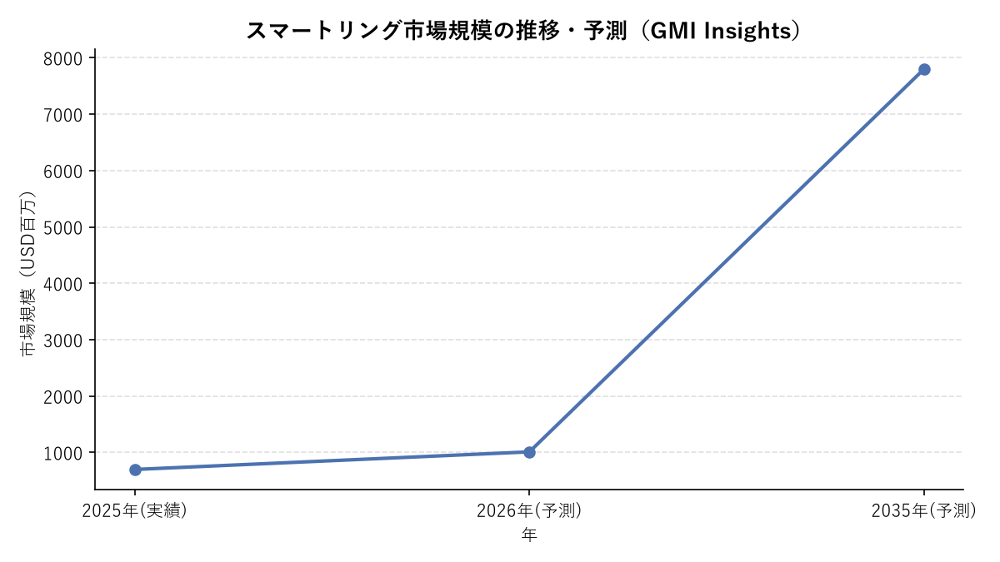

# 市場調査結果

案件ID: 2026-09-15_スマートリング特許調査
作成日: 2026-09-15

## 市場規模

スマートリング市場は、複数の調査会社が推計を公表しているが、各社で算出方法・セグメント定義（対象製品範囲、通貨、集計年度基準）が異なるため、金額水準にはばらつきがある。いずれの推計でも共通して**年率20〜30%台の高成長**が見込まれている点は一致している。ワールドワイド（グローバル）ベースの主要な推計値は以下の通り。

| 調査会社 | 2025年実績（推計） | 2026年予測 | 長期予測 | CAGR |
|---|---|---|---|---|
| GMI Insights (Global Market Insights) | USD 697.6百万 | USD 1,010百万（約1.01十億） | USD 7,800百万（2035年） | 25.4%（2026-2035） |
| Fortune Business Insights | USD 416.9百万 | USD 518.9百万 | USD 3,772.4百万（2034年） | 29.30%（2026-2034） |
| Grand View Research | ― | USD 502.4百万 | USD 2,079.3百万（2033年） | 22.5%（2026-2033） |
| Persistence Market Research | ― | USD 502.7百万 | USD 2,506.5百万（2033年） | 25.8%（2026-2033） |
| Future Market Insights | USD 300百万（2025年推計） | ― | USD 2,800百万（2035年） | 24.1%（2025-2035） |

（参考: Global Growth Insightsは2026年USD 41,020百万→2035年USD 260,450百万・CAGR 22.8%という大幅に異なる規模感を公表しているが、他社推計と桁が大きく乖離しており対象範囲の定義差によるものと考えられるため、本調査では参考値に留め主要テーブルには含めていない。）

### 市場規模の推移・予測グラフ

複数時点のデータが得られたため、GMI Insightsの推計（2025年実績・2026年予測・2035年長期予測の3時点）をもとにグラフ化した。

*出典: GMI Insights (Global Market Insights) の公表値をもとに作成。他社推計との比較は上表を参照。*

**地域別内訳**
- GMI Insights（2025年）: 北米 USD 270.3百万（最大市場）、欧州 USD 215.5百万、アジア太平洋 USD 161.5百万（最速成長、CAGR 26.3%）、中南米 USD 34.0百万、中東・アフリカ USD 16.3百万
- Fortune Business Insights（2025年）: 北米 USD 188.1百万（シェア45.10%、最大市場）、アジア太平洋 USD 125.6百万（シェア30.10%、最速成長地域＝中国・インド・日本が牽引）、欧州 USD 60.4百万（シェア14.50%）、中東・アフリカ USD 27.7百万（シェア6.60%）、中南米 USD 15.2百万（シェア3.70%）
- 両社の推計で金額水準は異なるが、「北米が最大、アジア太平洋が最速成長」というトレンドは一致している。

**セグメント別の高成長分野（Fortune Business Insights）**
- ヘルスケア用途: CAGR 39.3%
- 医療・臨床モニタリング用途: CAGR 40.7%
- NFC（非接触決済等）技術: CAGR 36.3%
- Eコマース（販売チャネル）: CAGR 36.7%
- Bluetooth接続方式: 市場の約59%を占める最大セグメント（GMI Insights）

## 主要プレイヤー

**市場シェア（2025年、GMI Insights推計）**
- Oura（市場リーダー）: 単独で約76.4%のシェアを占めるとの推計あり
- 上位5社（Oura、Ultrahuman、Renpho US、Noise、boAt）で合計85.9%

### Oura Health Oy（フィンランド）

- 業界のパイオニア・市場リーダー。睡眠トラッキング、回復インサイト、月経・妊活トラッキングに強み。
- 近年の開発動向・トピックス:
  - 2025年10月、Fidelity Management & Research主導・ICONIQ等参加でUSD 900百万超を調達し、評価額は約USD 110億に到達。
  - 2025年11月、CEOが2026年の売上見込みを約USD 20億（2025年見込みのUSD 10億から倍増）と発表。有料会員数は500万人突破が見込まれるとしている。
  - 2026年5月、SECに対しIPOの秘密裏の予備登録（confidential draft registration）を提出したと報じられている。
  - 2026年5月、最小・最薄モデル（従来比で約40%小型化）を発売。
  - 2026年に米テキサス州フォートワースで米国内製造拠点を開設予定（政府・法人顧客向けの国内サプライチェーン構築が狙い）。
  - Vida Health（遠隔心血管代謝ケア）、CorePower Yoga、The Sculpt Society、Technogym、Open等とのアクティビティ連携、Midi Health・Evernow・Maven Clinic・Progynyとの妊娠・更年期サポート連携を発表。
  - 特許面では、Samsung・Zepp Health（Amazfit）・Reebok・Noise・Nexxbase（Luna）等に対しITC提訴・東テキサス地区連邦地裁への提訴を行い、コア特許（'178特許「Wearable computing device」等）を根拠にロイヤリティ支払いを求める積極的な特許行使を展開。2025年10月にはITCがOura有利の裁定を下し、Ultrahumanの対米輸入が一時制限された。

### Samsung Electronics（韓国）

- Galaxy Ringをスマートウォッチ・スマートフォン等の自社エコシステムと連携させて展開。
- 近年の開発動向・トピックス:
  - 2025年7月、Xealthの買収に合意。病院500施設以上・ヘルスソリューションパートナー70社以上とつながる医療連携プラットフォームへの足がかりを獲得。
  - オリジナルのGalaxy Ringは、2026年秋にFDA認可の睡眠時無呼吸検知機能を追加予定。
  - 「Galaxy Ring 2」は2026年内投入が困難となり、2027年早期発売にずれ込む見通し。要因はバッテリー技術の刷新（9〜10日駆動目標）とOuraとの特許係争の両方とされる。
  - Ouraとの特許係争が激化: Ouraが2025年に東テキサス地区でSamsung・Zepp Health・Reebok・Noiseを提訴、Samsungも同地区でOuraを逆提訴するなど応酬が続いている。2024年にはSamsungがOuraを先制提訴したが、2025年初頭に連邦判事がこれを却下する場面もあった。

### Ultrahuman Healthcare Pvt Ltd（インド）

- Ring AIRシリーズで睡眠・回復・HRV・皮膚温・活動量に加え、自社の持続血糖モニター（M1）との統合を強み、サブスクリプション不要を訴求。
- 近年の開発動向・トピックス:
  - 2025年10月、米ITCがOura有利の裁定を下し、Ultrahumanのスマートリング対米輸入が一時制限される事態に。
  - 2026年2月、再設計した新モデル「Ring Pro」を発表（大型バッテリーでリング単体最大15日・充電ケース併用で最大45日駆動、デュアルコアプロセッサ搭載、AI機能強化）。価格はPRO充電器込みでUSD 479、早期予約はUSD 349から。
  - 2026年3月、米税関国境警備局（CBP）の許可を得てRing Proの米国輸入・展開を再開し、米国市場への巻き返しを図る。
  - 2026年9月、Qualcommベンチャー部門等から総額USD 70百万を調達（評価額USD 3.65億、2023年のUSD 1.2億から約3倍）。睡眠・健康トラッキングにとどまらず、リング上でソフトウェアを実行する「リング＝コンピュータ」化を目指すと報じられている。

### RingConn（中国系）

- サブスクリプション不要の継続課金なしモデルを訴求し、コストを重視する層に支持。
- 近年の開発動向・トピックス:
  - 2026年1月、CES 2026で新モデル「Gen 3」を発表。振動モーター（バイブレーションアラート）を新搭載し、血管系（vascular）トレンド分析機能を追加。将来アップデートで血圧インサイト機能の提供も予告。
  - サイズ展開はGen 2の9サイズから10サイズに拡充。価格はUSD 349。
  - 2026年9月、IFA 2026（ベルリン）にGen 3を出展。

### Circular（フランス）

- 欧州発のスマートリングブランド。過去にOuraから特許侵害で提訴された経緯がある。
- 近年の開発動向・トピックス:
  - 2026年9月、IFA 2026にて第3世代モデル「Circular Ring 3 Pro」「Circular Ring 3 Slim」の2機種を発表。旧モデル（Ring 2）より小型化し、同社特徴の触覚（バイブレーション）フィードバック機能を復活、両モデルともNFC非接触決済に対応。

### Mclear Limited（英国）

- 決済機能（NFC）に強みを持つスマートリングの先駆的企業の一つ。
- 近年の開発動向・トピックス: 特筆すべき動向は確認できず。

### Zepp Health Corporation（中国、Amazfitブランドの親会社）

- ウェアラブル全般を手掛ける中国大手。Amazfit Helio Ringを展開。
- 近年の開発動向・トピックス: 2025年、Oura HealthよりAmazfit Helio RingがOuraの特許（'178特許等）を侵害しているとして、東テキサス地区連邦地裁・ITCに提訴される。特許係争の当事者の一社となっている。

### Movano Health（米国）

- 医療グレードのヘルスモニタリングを志向するスマートリングを展開。
- 近年の開発動向・トピックス: 特筆すべき動向は確認できず（前回調査時点から更新情報を確認できなかった）。

### Reebok（F45 Trainingと提携、親会社Authentic Brands Group）

- スポーツブランドとしてフィットネス事業者との提携を通じて2025年10月に市場参入。
- 近年の開発動向・トピックス: 2025年、Oura HealthよりReebok Smart RingがOuraの特許を侵害しているとして東テキサス地区連邦地裁・ITCに提訴される。特許係争の当事者の一社となっている。

**その他の主要プレイヤー**
- Renpho US、Noise、boAt（いずれも比較的低価格帯で新興国市場等に強い。Noiseは2025年、Oura Healthより特許侵害訴訟の対象となった）
- Nexxbase（Luna Ring）: 2025年、Oura Healthより特許侵害訴訟の対象となった
- Smalth: 2026年1月、超薄型セラミックリングを発売、最大8日間のバッテリー持続を訴求
- Wellue、Amazfit（Zepp Health傘下ブランドとして上記に統合して記載）

### 今後の競争環境（大手テック企業の参入動向）

- **Apple**: 2024年10月時点でBloomberg記者Mark Gurman氏は近い将来の投入計画がないと報じていたが、2026年6月にリーカー「Kosutami」が「iRing」の開発が活発化していると主張。信頼度の高い情報源からの裏付けはまだなく、確度は不確実。仮に開発が進んでいても消費者向け投入は早くて2027年以降と見られる。
- **Samsung**: 既に参入済みだが「Galaxy Ring 2」は2027年早期にずれ込む見通し（バッテリー技術刷新とOuraとの特許係争が要因）。
- **業界全体の動き**: Oura対Samsung、Ultrahuman、Zepp Health（Amazfit）、Reebok、Noise、Nexxbase（Luna）といった特許係争が2025〜2026年にかけて急速に拡大しており、市場シェア構造だけでなく参入障壁・製品設計（電子部品の配置方式等）にも影響を与える可能性がある。

（本調査は前回調査（2026-09-14実施）と同一の調査観点・調査対象で実施したワールドワイド市場調査であり、企業ごとの詳細プロフィール（会社規模・SWOT等）は作成していない。詳細な企業調査が必要な場合は追加依頼をお願いしたい。）

## トレンド

1. **ヘルスケア・予防医療シフトの加速**: 心拍数・睡眠・血中酸素・HRV（心拍変動）など複数の生体指標を継続的にモニタリングできる点が支持されている。医療・臨床モニタリング用途は市場内で最も高い成長率（CAGR 40.7%）を示す見込み。
2. **特許係争の急拡大（本調査で新たに顕在化した最重要トレンド）**: Oura Healthが2025年後半以降、Samsung・Zepp Health（Amazfit）・Reebok・Noise・Nexxbase（Luna）を対象に、ITC提訴・東テキサス地区連邦地裁提訴を相次いで実施。Samsungも逆提訴するなど応酬が激化しており、業界全体の設計自由度・新規参入障壁に直結する動きとなっている。特許出願・権利化戦略の重要性が一段と高まっている。
3. **保険・法人ウェルネス領域との連携**: Ouraによる医療機関向け連携拡大（Vida Health等）や、Samsungによる病院・ヘルスソリューションパートナー向けプラットフォーム構築（Xealth買収）など、B2B・医療連携領域への展開が加速。
4. **AI統合・オンデバイスコンピューティングへの進化**: Ultrahumanが「リングをコンピュータ化する」構想を掲げ、Qualcommの支援を受けてデュアルコアプロセッサ搭載モデルを投入するなど、単なるセンシングデバイスから処理能力を持つデバイスへの進化が始まっている。
5. **非接触決済（NFC）機能の標準化**: Circular Ring 3、Samsung Galaxy Ring 2（予定）等、NFC対応が新モデルの標準装備になりつつある（NFCセグメントCAGR 36.3%）。
6. **バッテリー・フォームファクタの継続的な進化**: Ultrahuman Ring Pro（単体15日・ケース併用45日）、Samsung Galaxy Ring 2（9〜10日目標）、Smalth（セラミック素材で最大8日）など、長寿命化・小型軽量化の競争が続く。Ouraも2026年5月に従来比40%小型化した最小モデルを投入。
7. **サブスクリプション有無による差別化**: Oura等が月額課金モデルを採用する一方、RingConn・Ultrahuman等は「サブスクリプション不要」を訴求し、価格・継続コストを重視する層を取り込む動きが継続。
8. **資金調達の活発化・IPO機運**: Ouraが2025年10月にUSD 900百万超を調達（評価額約USD 110億）し2026年5月にIPO予備申請、Ultrahumanも2026年9月にQualcomm等からUSD 70百万を調達するなど、業界への投資マネー流入が加速している。
9. **大手テック企業の参入観測（不確実性を伴う）**: Appleの「iRing」開発観測が2026年6月に浮上したが裏付けは限定的。実現すれば競争構造が大きく変動する可能性がある一方、Samsungは既存モデルの後継投入自体が2027年にずれ込んでおり、大手の動きにも遅延リスクがある。
10. **地域展開**: 北米が最大市場である一方、中国・インド・日本を中心とするアジア太平洋地域が最速の成長率（CAGR 26.3%、GMI Insights）を示しており、今後の主戦場になり得る。

## 出典・参考URL

- [GMI Insights (Global Market Insights) - Smart Rings Market Size, Forecasts Report 2026-2035](https://www.gminsights.com/industry-analysis/smart-rings-market)
- [Fortune Business Insights - Smart Ring Market Size, Share | Industry Report [2026-2034]](https://www.fortunebusinessinsights.com/smart-ring-market-111418)
- [Grand View Research - Smart Rings Market Size And Share Report, 2026-2033](https://www.grandviewresearch.com/industry-analysis/smart-rings-market-report)
- [OpenPR - Smart Rings Market to Reach US$2,506.5 Million by 2033 at 25.8% CAGR (Persistence Market Research)](https://www.openpr.com/news/4606314/smart-rings-market-to-reach-us-2-506-5-million-by-2033-at-25-8)
- [Future Market Insights - Smart Rings Market Global Analysis Report - 2035](https://www.futuremarketinsights.com/reports/smart-rings-market)
- [Global Growth Insights - Smart Ring Market Trends | Forecast & Strategic Outlook](https://www.globalgrowthinsights.com/market-reports/smart-ring-market-121958)
- [CNBC - Smart ring maker Oura expects close to $2 billion in 2026 sales: CEO](https://www.cnbc.com/2025/11/11/smart-ring-maker-oura-expects-close-to-2-billion-in-2026-sales-ceo.html)
- [Business Wire - ŌURA Raises Over $900M to Accelerate Global Expansion and Health Innovation](https://www.businesswire.com/news/home/20251014306417/en/URA-Raises-Over-$900M-to-Accelerate-Global-Expansion-and-Health-Innovation)
- [CNBC - Oura, smart ring maker, files confidentially for IPO](https://www.cnbc.com/2026/05/21/oura-smart-ring-ipo-filing.html)
- [CNBC - Oura is launching its smallest smart ring yet, shrinking wearable design by 40%](https://www.cnbc.com/2026/05/28/oura-ring-smallest-wearable-health-fitness.html)
- [9to5Google - Samsung 'Galaxy Ring 2' likely launching 'early' 2027 with battery, hardware upgrades](https://9to5google.com/2026/05/06/samsung-galaxy-ring-2-upgrade-release-date-report/)
- [Gadgets and Wearables - Samsung confirms Galaxy Ring 2 is in the works but launch may slip to 2027](https://gadgetsandwearables.com/2026/06/29/samsung-galaxy-ring-2-2027/)
- [Wareable - Fresh Apple smart ring rumor suggests 'iRing' enters active development](https://www.wareable.com/wearable-tech/apple-smartring-iring-active-development-rumor-report)
- [TechCrunch - Ultrahuman unveils new smart ring as it awaits U.S. clearance after Oura dispute](https://techcrunch.com/2026/02/27/ultrahuman-unveils-new-smart-ring-as-it-awaits-u-s-clearance-after-oura-dispute/)
- [TechCrunch - Ultrahuman ramps up U.S. push with Ring Pro as Oura tightens its grip](https://techcrunch.com/2026/03/24/ultrahuman-ramps-up-u-s-push-with-ring-pro-as-oura-tightens-grip/)
- [TechCrunch - Qualcomm backs Ultrahuman in $70M round on bet to turn smart rings into computers](https://techcrunch.com/2026/09/03/qualcomm-backs-ultrahuman-in-70m-round-on-bet-to-turn-smart-rings-into-computers/)
- [PR Newswire - RingConn Showcases Gen 3 Smart Ring at IFA 2026](https://www.prnewswire.com/news-releases/ringconn-showcases-gen-3-smart-ring-at-ifa-2026-302862493.html)
- [AndroidHeadlines - RingConn's New Gen 3 Vibrates to Alert You of Health Risks](https://www.androidheadlines.com/2026/01/ringconn-gen-3-smart-ring-debuts-ces-2026.html)
- [T3 - Circular is taking another swing at smart rings with two new models (IFA 2026)](https://www.t3.com/active/fitness-trackers/circular-ring-3-series-ifa-0926)
- [SamMobile - Oura sues Samsung over patents related to the Galaxy Ring](https://www.sammobile.com/news/oura-sues-samsung-galaxy-ring-patents/)
- [Android Central - The Oura-Samsung smart ring patent battle is about to explode](https://www.androidcentral.com/wearables/oura-ring/oura-sues-samsung-amazfit-as-it-demands-royalty-payments-from-remaining-smart-ring-rivals)
- [Ouraring.com Pulse Blog - Oura Files ITC Action Against Samsung, Reebok, Zepp Health, and Nexxbase for Patent Infringement](https://ouraring.com/blog/itc-action-patent-infringement/)
- [ip fray - Samsung retaliates against Oura's ITC complaint with own E.D. Tex. patent infringement allegations](https://ipfray.com/samsung-retaliates-against-ouras-itc-complaint-with-own-e-d-tex-patent-infringement-allegations-against-smart-ring-maker-who-just-defended-core-patent-at-ptab/)
- [Korea JoongAng Daily - Samsung takes on Finland's Oura in smart ring patent dispute](https://www.koreajoongangdaily.com/business/samsung-takes-on-finlands-oura-in-smart-ring-patent-dispute/)
- 前回調査: `projects/_archive/2026-09-14_スマートリング特許調査/01_research/market/market_research_output.md`
