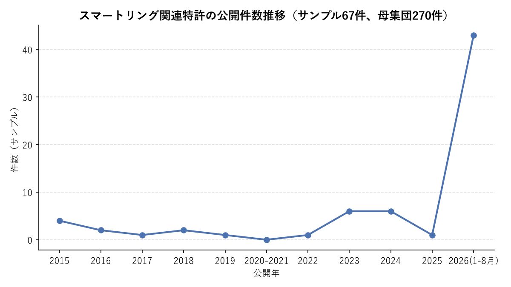
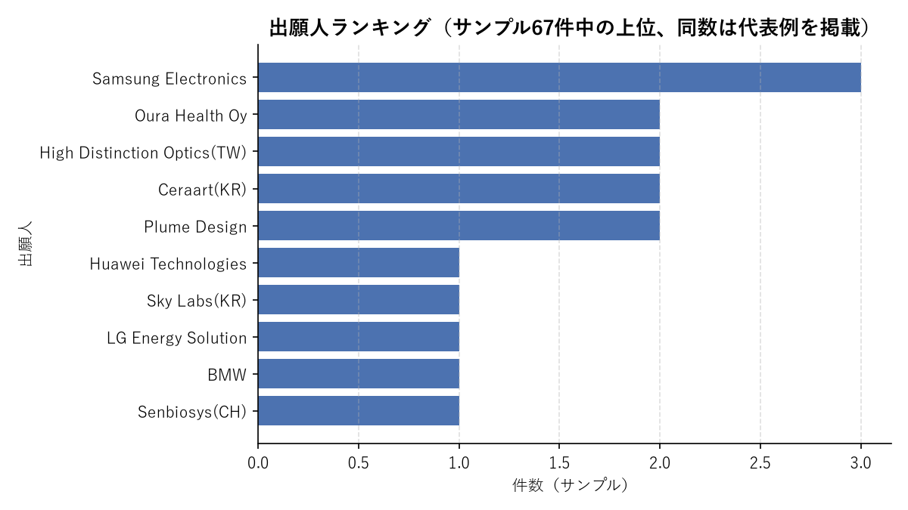

# 特許調査結果

案件ID: 2026-09-15_スマートリング特許調査
作成日: 2026-09-15

## 使用した検索式

EPO OPS（`patent-search-mcp`）のCQL検索式で、スマートリング関連技術全般（生体センシング／通信／バッテリー・充電／装着感・フォームファクタ／UI-UX）を広く俯瞰するため、タイトル・要約に "smart ring" を含む文献を対象期間指定なし（実質的に2015〜2026年の公開分）で検索した。

```
(ti="smart ring" OR ab="smart ring") AND pd within "2015-2026"
```

- 総ヒット件数: **270件**（`search_patents` の `total-result-count`）
- 検索式の調整過程: 当初 `ti,ab="smart ring"` の記法を試みたところOPS側の解釈が意図と異なり4件のみヒットしたため、`(ti="smart ring" OR ab="smart ring")` の明示的なOR結合に変更し270件を得た。
- ヒット母集団には、ウェアラブル技術としての「スマートリング」だけでなく、同名の玩具・パズルリング（例: Hanayama International Trading社の意匠的知恵の輪製品）や、スマートリングへの言及がある周辺技術（アンテナモジュール、周辺ウェアラブル連携等）も一部混在する。これらは集計上除外せず母集団に含めているが、各特許のサマリでは技術的に本調査観点に合致するものを優先して取り上げた。

### 集計方法の補足（出願推移・出願人ランキング）

`search_patents` は書誌番号のみを返すため、公開年・出願人を得るには個々に `get_bibliographic_data` を追加取得する必要がある。全270件を取得すると膨大になるため、以下の層化サンプリングで**67件**の書誌データを取得し、集計に用いた。

- ランク1〜40位（最新公開順の上位全件）
- ランク101〜130位、171〜200位、241〜270位から各8〜10件を抽出

このため後述の出願推移グラフは2026年（1〜8月）分が相対的に多くサンプリングされている点に注意されたい（母集団270件中のサンプル67件による推計であり、悉皆調査ではない）。

## 対象特許リスト

深掘り対象として、技術分野（生体センシング／通信／バッテリー・充電／装着感・フォームファクタ／UI-UX）を横断するよう選定した。

| 特許番号 | 出願人 | 出願日 | タイトル |
|---|---|---|---|
| WO2026106176 A1 | Sky Labs Inc（韓国） | 2025-10-27 | Smart Ring Device for Electrocardiography |
| WO2026079901 A1 / KR20260050909 A | Samsung Electronics | 2025-10-02 | Smart Ring Device for Identifying Posture of User |
| KR102981847 B1 | 韓林大学校産学協力団 | 2025-07-25 | Smart Ring-Based Patient Monitoring System |
| CN122161541 A | Ultrahuman Health Pty Ltd | 2025-08-07 | Replaceable Sensor Assembly Intelligent Ring |
| MA70860 A1 | Univ. Euro-Méditerranéenne de Fès | 2025-02-21 | AIによる急性冠症候群早期検知スマートリング |
| WO2026172136 A1 | 個人（イラン） | 2025-04-17 | UVセンサ搭載・皮膚がんリスク評価スマートウェアラブル |
| US20260060604 A1 | Senbiosys（スイス） | 2025-09-03 | マイクロ流体式発汗コレクター搭載リング |
| DE102024121837 A1 | BMW（Bayerische Motoren Werke） | 2024-07-31 | スマートリング経由の車両アクセス（通信・デジタルキー） |
| US20260023426 A1 / WO2026020042 A1 | Oura Health Oy | 2025-07-16 | 複数ウェアラブル連携（スマートリング×ARグラス） |
| KR20260112914 A | Connected In Corp | 2025-10-31 | スマートリング基盤の糖尿病患者行動・アラーム管理 |
| KR102919103 B1 | Creativemut Co Ltd | 2025-06-04 | NFC搭載アーティストアルバム連携リング |
| WO2026157625 A1 | 華為技術（Huawei） | 2025-12-11 | 形状記憶合金採用リングハウジング（サイズ可変） |
| KR102941362 B1 | Remotesolution Co Ltd | 2025-07-18 | スペーサー式指囲調整スマートリング |
| KR102909808 B1 / 102909809 B1 | Ceraart Co Ltd | 2024-10-30 | 偏心輪による内径調整スマートリング（通気性改善） |
| US20260090614 A1 | 個人（インド） | 2025-10-08 | 非導電性・指囲可変スマートリング（決済・安全解除機構） |
| CA245659 S | Shenzhen Shufang Innovation Tech | 2025-11-14 | スマートリング用充電ベース（意匠） |
| KR20260042642 A | LG Energy Solution | 2024-09-23 | ヒンジ構造バッテリー搭載スマートリング |
| DE202025107600 U1 | Shenzhen Chenbei Technology | 2025-12-10 | リング周方向溝にバッテリーを収納する構造 |
| WO2026067894 A1 | Shenzhen Arcension Technology | 2025-11-20 | 回転＋押下の二段階操作トリガー機構（UI/UX） |
| CN122450282 A | Lok Rocket Corp | 2025-01-22 | 押下回数に応じた動作モード切替（UI/UX） |

## 出願推移



| 年 | 件数（サンプル） |
|---|---|
| 2015 | 4 |
| 2016 | 2 |
| 2017 | 1 |
| 2018 | 2 |
| 2019 | 1 |
| 2020-2021 | 0（未サンプリング区間、実際の件数はゼロと断定できない） |
| 2022 | 1 |
| 2023 | 6 |
| 2024 | 6 |
| 2025 | 1 |
| 2026（1-8月） | 43 |

※ 母集団270件のうち67件を層化サンプリングして集計した推計値。ランク1〜40位（最新公開順）を全件、それ以外は各年代の代表として抽出したため2026年分が相対的に厚く出ている。2020〜2021年はサンプル区間に該当がなかっただけで、実際にゼロ件だったことを意味しない。全体としては2023年以降にスマートリング関連特許（Oura・Samsung・Huaweiの参入や消費者向け製品の普及と符合）が明確に増加している傾向が確認できる。

## 出願人ランキング



| 順位 | 出願人 | 件数（サンプル） |
|---|---|---|
| 1 | Samsung Electronics | 3 |
| 2 | Oura Health Oy | 2 |
| 2 | High Distinction Optics（台湾） | 2 |
| 2 | Ceraart Co Ltd（韓国） | 2 |
| 2 | Plume Design Inc（米国） | 2 |
| 6 | Huawei Technologies | 1 |
| 6 | Sky Labs Inc（韓国） | 1 |
| 6 | LG Energy Solution | 1 |
| 6 | BMW | 1 |
| 6 | Senbiosys（スイス） | 1 |

※ サンプル67件内での出現件数（同一発明のWO・各国移行案件を別カウント）に基づく暫定順位であり、ファミリー名寄せ・悉皆調査による確定順位ではない。個人発明家・大学・中小スタートアップによる単発出願が非常に多く（サンプル67件中20件超）、業界の参入障壁の低さ・市場の黎明期的性格がうかがえる。なお、玩具・知恵の輪の「智慧環／Smart Ring」を製造するHanayama International Trading（中国）もサンプル中3件ヒットしているが、本調査の対象であるウェアラブル技術とは異なるため上記ランキングからは除外した。

## 各特許のサマリ

### 特許番号：WO2026106176 A1（Sky Labs Inc）

- 概要：指に接触する複数電極（3電極）をリング内周に配置し、心電図（ECG）を測定するスマートリング。従来の光学式PPGだけでなく電気的バイオシグナルを取得する点が特徴。
- 注目ポイント：Sky Labs社はSamsung・Hexacheck等と共に韓国発の心疾患モニタリング領域の主要プレイヤーであり、引用文献にもSamsung Electronicsの類似出願が挙がっている。生体センシングの精度向上（複数電極化）が競争軸になっていることを示す。

### 特許番号：WO2026079901 A1 / KR20260050909 A（Samsung Electronics）

- 概要：リング内周の導電部とRFカプラーを用い、信号送受信時のインピーダンス変化から装着部位（指）の姿勢を推定し、AIモデルの入力として活用する技術。
- 注目ポイント：単なるバイタル計測に留まらず、ジェスチャー・姿勢推定という新しいUI/UX領域にセンシング技術を応用している点が特徴的。Samsungは同時に「開閉式リング面による指囲調整」（KR20260028368）も出願しており、センシングとフォームファクタの両面から布石を打っている。

### 特許番号：KR102981847 B1（韓林大学校産学協力団）

- 概要：スマートリングで取得した生体情報を第1周期で収集し、医療行為中は第2周期（より高頻度）に切り替えて送信する患者モニタリングシステム。
- 注目ポイント：大学発の出願であり、医療機関向け（入院患者モニタリング）用途に特化した実装面の工夫（送信周期の動的切替）に価値を置いている。

### 特許番号：CN122161541 A（Ultrahuman Health Pty Ltd）

- 概要：開放式のアーチ型チューブ状ハウジングにセンサーモジュール（PCB）とレンズを収め、CNC加工の底蓋で密閉する交換可能なセンサーアセンブリ構造。
- 注目ポイント：Ultrahumanはインド発のOuraライバルとして急成長しているスマートリングブランド。センサー部を交換可能にすることで、リング本体の長寿命化・アップグレード性を狙った設計思想がうかがえる。

### 特許番号：US20260060604 A1（Senbiosys）

- 概要：リング内周にPPGセンサーとマイクロ流体式の発汗収集機構を設け、充電ドック側で光学分析（分光・ラマン分光等）によりバイオマーカーを解析する仕組み。
- 注目ポイント：リング本体の小型化・省電力制約を回避するため、詳細分析を「充電時のドック側」に担わせる設計は他社にあまり見られないアプローチで、汗由来バイオマーカー計測という新領域への展開を示唆する。

### 特許番号：DE102024121837 A1（BMW）

- 概要：スマートリングとスマートフォンを連携させ、リング上での「施錠アクション」をBluetooth経由で車両アクセスモジュールに伝達し、施解錠を行う技術。
- 注目ポイント：自動車メーカーによる出願であり、スマートリングを健康管理デバイスではなく「デジタルキー」として応用する通信・セキュリティ領域への横展開事例。

### 特許番号：US20260023426 A1 / WO2026020042 A1（Oura Health Oy）

- 概要：スマートリングとスマートグラス（AR）を連携させ、リングが視界に入った際にARグラス側でリアルタイムの心拍数等をオーバーレイ表示する複数ウェアラブル連携技術。
- 注目ポイント：業界最大手Ouraが単体デバイスの精度競争だけでなく、他ウェアラブルとのエコシステム連携・UX拡張に投資している点が確認できる。

### 特許番号：WO2026157625 A1（Huawei）

- 概要：形状記憶合金製のリングハウジングを用い、変形により指囲を調整・維持できるようにした構造。
- 注目ポイント：Huaweiはスマートウォッチで培った量産・小型化技術をリングに展開しており、フォームファクタ（サイズ可変）分野での技術的優位性を狙っていると考えられる。

### 特許番号：KR102941362 B1／KR102909808 B1・102909809 B1（Remotesolution／Ceraart）

- 概要：前者はスペーサーの脱着による内径調整、後者は偏心輪の回転による内径調整という、異なる方式でワンサイズ対応を実現する機構。
- 注目ポイント：装着感・フォームファクタ領域では「指囲の個人差にどう対応するか」が各社共通の技術課題となっており、韓国の複数の中小メーカーが独自方式で特許化を進めている。

### 特許番号：WO2026067894 A1（Shenzhen Arcension Technology）／CN122450282 A（Lok Rocket Corp）

- 概要：前者は接触部の「回転」と「押込み」という2種類の動作をそれぞれ異なる電気信号として検出し外部機器を操作するUIトリガー機構。後者はボタンの押下回数に応じて動作モードを切り替える方式。
- 注目ポイント：ディスプレイを持たないスマートリングにおいて、限られた操作系（回転・押下・タップ回数）でいかに多様な機能を割り当てるかというUI/UX設計が特許化の主戦場になっている。

### 特許番号：CA245659 S（Shenzhen Shufang）／DE202025107600 U1（Shenzhen Chenbei）／KR20260042642 A（LG Energy Solution）

- 概要：それぞれ「専用充電ベースの意匠」「リング周方向の溝へのバッテリー収納構造」「ヒンジ構造による電池搭載」という、バッテリー搭載・充電に関する異なるアプローチ。
- 注目ポイント：小型リング筐体内でのバッテリー容積確保と充電の利便性確保はハード設計上の大きな制約であり、LG Energy Solutionのようなバッテリーメーカー自身がリング形状に最適化した電池構造で特許を取得している点は、コンポーネントメーカーの参入という観点で注目に値する。

## 出典・参考URL

- EPO Open Patent Services（OPS） `published-data/search`（CQL: `(ti="smart ring" OR ab="smart ring") AND pd within "2015-2026"`）
- 個別書誌情報: EPO OPS `published-data/publication/docdb/{番号}/biblio,abstract`
- Espacenet（人手での追加確認用）: https://worldwide.espacenet.com/patent/search?q=%28ti%3D%22smart%20ring%22%20OR%20ab%3D%22smart%20ring%22%29
