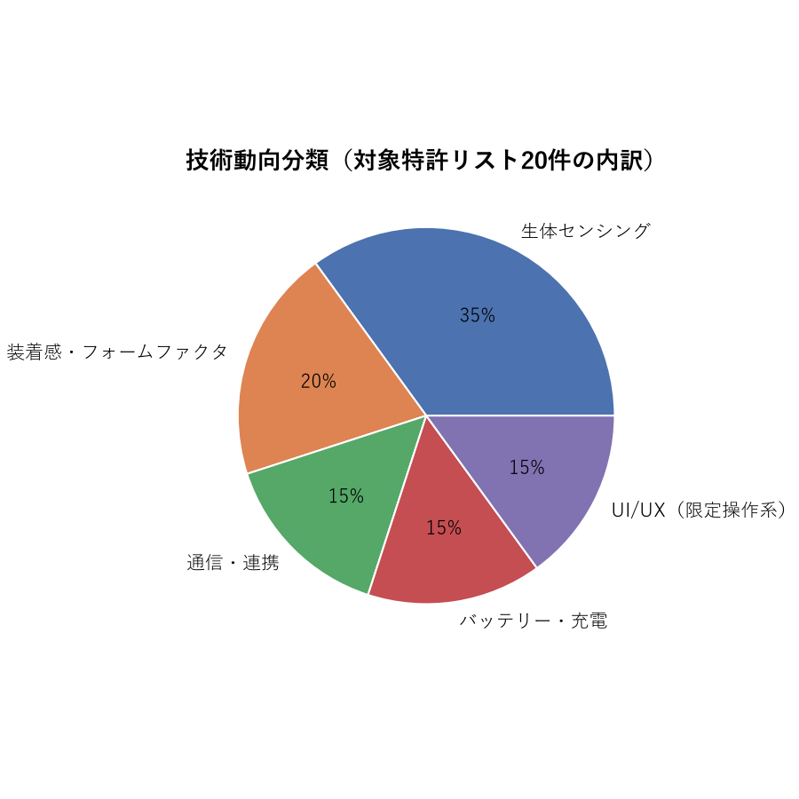
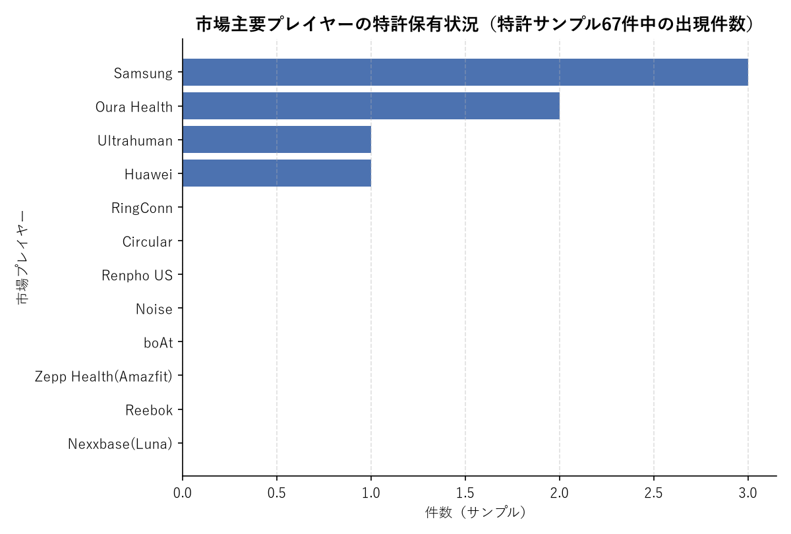

# 分析結果

案件ID: 2026-09-15_スマートリング特許調査
作成日: 2026-09-15

## 技術動向分類

特許調査で選定した対象特許リスト20件（`01_research/patent/research_output.md`）を、5つの技術カテゴリに分類した。

| カテゴリ | 件数 | 代表的な出願・特徴 |
|---|---|---|
| 生体センシング | 7 | Sky Labs（ECG電極）、韓林大学校（患者モニタリング）、Ultrahuman（交換可能センサー）、Univ. Euro-Méditerranéenne de Fès（AI冠症候群検知）、個人・イラン（UVセンサー）、Senbiosys（発汗バイオマーカー）、Connected In（糖尿病管理） |
| 装着感・フォームファクタ | 4 | Huawei（形状記憶合金）、Remotesolution（スペーサー式サイズ調整）、Ceraart（偏心輪サイズ調整）、個人・インド（可変指囲＋決済機構） |
| 通信・連携 | 3 | BMW（車両アクセス連携）、Oura（ARグラス連携）、Creativemut（NFCアルバム連携） |
| バッテリー・充電 | 3 | Shenzhen Shufang（充電ベース意匠）、LG Energy Solution（ヒンジ構造電池）、Shenzhen Chenbei（周方向溝収納構造） |
| UI/UX（限定操作系） | 3 | Samsung（姿勢推定によるジェスチャーUI）、Shenzhen Arcension（回転＋押下トリガー）、Lok Rocket（押下回数によるモード切替） |

**傾向の読み解き**:
- **生体センシング**が全体の35%を占め最大カテゴリ。ただし内訳は光学式PPGの精緻化ではなく、ECG電極・発汗バイオマーカー・UVセンサーなど**非典型モダリティへの多様化**が目立つ。単純なPPG精度競争は成熟しつつあり、新規モダリティが次の差別化軸になっていると考えられる。
- **装着感・フォームファクタ**（サイズ調整機構）は韓国系中小メーカー（Ceraart、Remotesolution）が独自方式を競って特許化しており、指囲の個人差対応が業界共通の技術課題であることを裏付ける。
- **バッテリー・充電**では、LG Energy Solutionのような電池セルメーカー自身がリング形状に最適化した構造で出願しており、**コンポーネントメーカーの参入**という新しい動きが見られる。
- **通信・連携**では、BMW（デジタルキー）のような異業種からの参入が確認でき、ヘルスケア用途以外への応用展開が始まっている。

## 競合マッピング

市場調査で特定した主要プレイヤー（市場シェア・話題性の観点）が、特許調査のサンプル67件の中にどれだけ自社出願を持つかを突き合わせた。

| 市場プレイヤー | 市場シェア／位置づけ（市場調査より） | 特許サンプル67件中の件数 | Ouraの特許訴訟における立場 |
|---|---|---|---|
| Samsung | Galaxy Ring展開、自社エコシステム連携 | 3 | 被告（Ouraを逆提訴） |
| Oura Health | 市場リーダー（シェア約76%） | 2 | 原告（コア特許でITC・連邦地裁提訴） |
| Ultrahuman | 市場シェア上位、急成長 | 1 | ITC裁定で一時輸入制限を受けた当事者 |
| Huawei | スマートウォッチ由来の量産技術を展開 | 1 | ― |
| RingConn | サブスク不要モデルで存在感 | 0 | ― |
| Circular | 欧州発、過去にOuraから提訴された経緯 | 0 | 被告（過去） |
| Renpho US / Noise / boAt | 市場シェア上位5社の一角（低価格帯） | 0 | Noiseは被告 |
| Zepp Health（Amazfit） | ウェアラブル大手 | 0 | 被告 |
| Reebok | 2025年新規参入 | 0 | 被告 |
| Nexxbase（Luna） | 欧州ブランド | 0 | 被告 |

**読み解き**:
- 特許サンプル内で複数件を確保しているのは**Samsung・Oura・Ultrahuman・Huawei**という、いずれも自社で研究開発機能を持つ大手のみ。
- 一方、**市場シェア上位5社のうちRenpho US・Noise・boAtを含む多くのブランドが、本調査のサンプルでは自社特許が確認できなかった**。これらの企業の多くはOura Healthの特許訴訟（ITC・東テキサス地区連邦地裁）で**被告側**に回っており、「自社IPを持たずOEM調達等で製品展開しているブランドほど、他社特許の権利行使リスクに晒されやすい」という構図が読み取れる。
- Ceraart・High Distinction Optics・Plume Design（特許出願件数では上位）は市場調査側で消費者ブランドとして名前が挙がっておらず、**部品・OEMサプライヤー層**である可能性が高い。最終製品ブランドと特許保有企業が必ずしも一致しない、レイヤー構造の市場であることを示唆する。

## 市場×特許の突き合わせ（ホワイトスペース分析等）

市場調査で挙げられた高成長・注目セグメントと、特許調査で確認された技術動向を突き合わせ、特許の「厚み」に偏りがないかを分析した。

| 市場側の注目領域 | 市場側の成長性 | 特許側の状況 | ホワイトスペース評価 |
|---|---|---|---|
| ヘルスケア・医療モニタリング用途 | CAGR 39.3%（ヘルスケア）／40.7%（医療・臨床）と最高水準 | 生体センシング特許が最多（7/20）。ただしSky Labs・韓林大学校・Univ. Euro-Méditerranéenne de Fès等、大学・中小発の出願が多い | 需要と特許件数はおおむね対応。ただし大手ブランドによる非典型モダリティ（ECG・発汗・UV）の権利化はまだ手薄で、**M&A・技術提携による取り込み余地**あり |
| NFC非接触決済 | NFCセグメントCAGR 36.3%。Circular Ring 3・Galaxy Ring 2で標準搭載化が進行 | サンプル中でNFC/決済関連は2件のみ（Creativemut、個人・インド） | **ホワイトスペース**：市場での重要性の高まりに対し特許の蓄積が薄い。決済・セキュア認証まわりの権利化を先行させる余地がある |
| バッテリー・駆動時間競争 | Ultrahuman最大15日、Samsung目標9-10日、Smalth最大8日等、各社が駆動時間を訴求 | サンプル中3件のみで、かつ主要ブランド（Oura/Samsung/Ultrahuman）自身の電池技術特許は未確認（LG Energy Solutionのみ具体的な電池構造） | **ホワイトスペース**：ブランド側は電池セル技術を外部（LG等）に依存している可能性が高く、自社での電池技術の権利化・提携強化が差別化機会になりうる |
| UI/UX（限定操作系） | ディスプレイなしデバイスでの操作性は各社共通の課題（市場調査では明示的言及は少ないが製品差別化要因） | サンプル3件はいずれも中国系中小企業（Shenzhen Arcension、Lok Rocket）＋Samsung1件。大手ブランドの厚みは薄い | **ホワイトスペース**：将来「リングをコンピュータ化する」（Ultrahumanの方針）流れが進むほど操作体系の重要性が増す。今のうちに独自UI特許を確保できれば先行者優位を築ける可能性 |
| 特許係争・基本特許の権利行使 | Oura対Samsung/Zepp Health/Reebok/Noise/Nexxbaseの訴訟が急拡大（市場調査の最重要トレンド） | Ouraの基本特許（'178特許「Wearable computing device」等）を軸にした訴訟が展開中。本調査ではOura自身の基本特許の内容までは深掘りできていない | **リスク領域**：新規参入・自社開発を検討する場合、Ouraの基本特許ポートフォリオとの抵触リスク精査が必須。特許調査の追加深掘り対象として推奨 |

## 総括・示唆

1. **市場・特許の両輪で急拡大期**：市場は2025→2035年でCAGR20〜30%台の高成長が見込まれる一方、特許出願も2023年以降急増しており（`01_research/patent/research_output.md`の出願推移参照）、技術開発と権利化が同時並行で進む黎明期にある。今が権利化のタイミングとして重要な局面。
2. **Ouraの「市場シェア×基本特許」による二重の優位性**：市場シェア約76%というプロダクト面の優位性に加え、コア特許（'178特許等）を根拠にSamsung・Zepp Health・Reebok・Noise・Nexxbaseを提訴するなど、**知財を武器にした参入障壁構築**を進めている。自社が新規参入・製品開発する場合、Ouraの基本特許との抵触リスク精査を最優先事項とすべき。
3. **「特許を持たないブランド」ほど訴訟対象になりやすい構図**：市場シェア上位でも自社特許が確認できないブランド（Renpho US、Noise、boAt、Reebok、Zepp Health、Nexxbase等）の多くがOuraの提訴対象となっている。OEM調達中心の事業展開はスピードで有利な反面、他社特許の権利行使に対して脆弱になりやすい。自社開発を検討する際は、製品開発と並行した自社IP確保（防御目的を含む）が重要。
4. **ホワイトスペース候補は「NFC決済」「電池セル技術」「UI/UX（限定操作系）」の3領域**：いずれも市場側で重要性が高まっている一方、特許側の厚みが相対的に薄い、または大手ブランド自身の出願が少ない。早期の権利化・技術提携によって先行者優位を築ける可能性がある。
5. **生体センシングは非典型モダリティへの多様化が競争軸**：光学式PPGでの精度競争は成熟しつつあり、ECG電極（Sky Labs）、発汗バイオマーカー（Senbiosys）、UVセンサー（個人・イラン）等、新しいセンシングモダリティへの展開が次の差別化ポイントになっている。
6. **異業種・コンポーネントメーカーの参入が増加**：BMW（デジタルキー）、LG Energy Solution（電池構造）のような周辺インダストリーからの参入が見られ、単独ブランドでの垂直統合だけでなく、他業種との提携・コンポーネント調達戦略も選択肢になり得る。
7. **次の調査への示唆**：Ouraの基本特許（'178特許等）のクレーム範囲の詳細調査、および出願人ファミリー名寄せによる悉皆的な出願人ランキングの精緻化が、自社の特許性判断・参入戦略検討の精度向上に有効と考えられる。
